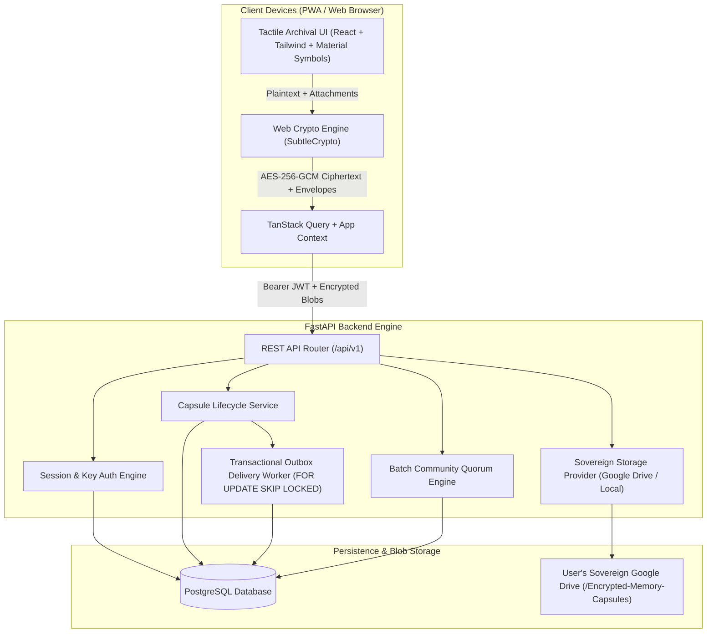

# System Architecture — Agni's Capsule

## Overview
**Agni's Capsule** (*"Your memories have a future."*) is an encrypted digital time-capsule and future-message platform combining tactile archival editorial aesthetics with client-side zero-knowledge cryptography and reliable transactional background delivery.

## High-Level Architecture

## Key Architectural Principles
1. **Zero-Knowledge by Construction**: Plaintext capsule messages and media are encrypted in the user's browser before transmission. The backend receives only encrypted ciphertexts and recipient key envelopes.
2. **Reliable Transactional Delivery Engine**: Capsules scheduled for future release are managed via a database-backed transactional outbox worker utilizing `FOR UPDATE SKIP LOCKED`, exponential backoff retries, and unique idempotency keys.
3. **Sovereign Storage**: Each user can link their own Google Drive account under the minimal `drive.file` scope. Files are organized under `/Encrypted-Memory-Capsules`.
4. **Individual Recipient Tracking**: Acknowledgements are tracked per recipient. A delivery or reading action by one recipient never halts reminders for others.

