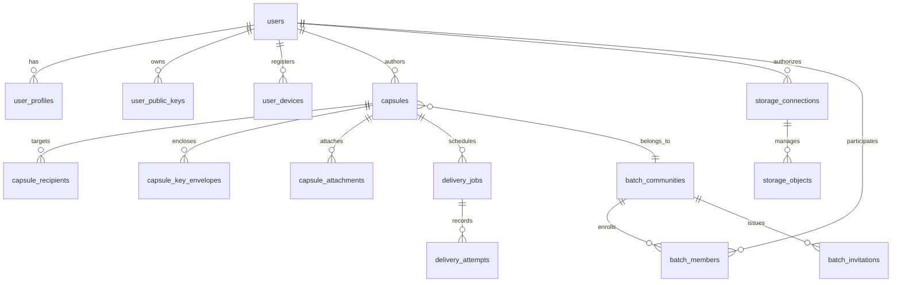

# Database Architecture & Schema — Agni's Capsule

## Overview
The persistence layer utilizes PostgreSQL (with zero-config SQLite compatibility for local developer evaluation). All primary keys are UUIDs, and all timestamp columns store UTC timezone-aware values (`DateTime(timezone=True)`).

## Entity Relationship Diagram

## Tables & Model Index
- **`users`**: Authentication credentials, verification state, account timestamps.
- **`user_profiles`**: Cadets' full name, university department, graduation year, roll number, avatar.
- **`user_public_keys`**: Client-side generated public keys and cryptographic fingerprints.
- **`capsules`**: Title, AES-GCM ciphertext, IV, status (`draft`, `scheduled`, `delivered`, `opened`, `cancelled`), delivery target UTC time, original timezone.
- **`capsule_recipients`**: Target recipient email, acknowledgement status (`pending`, `delivered`, `opened`, `acknowledged`), timestamp.
- **`capsule_key_envelopes`**: Recipient-specific encrypted symmetric capsule keys.
- **`capsule_attachments`**: Enclosed polaroids, documents, and voice recordings.
- **`delivery_jobs`**: Transactional outbox scheduler records with idempotency keys and retry counts.
- **`batch_communities`**: Cohort ledgers (e.g. B.Tech CSE Batch of 2027), convocation countdowns, epoch IDs.
- **`batch_members`**: Cadets, Class Guardians, and Archivists enrolled in cohort quorums.

